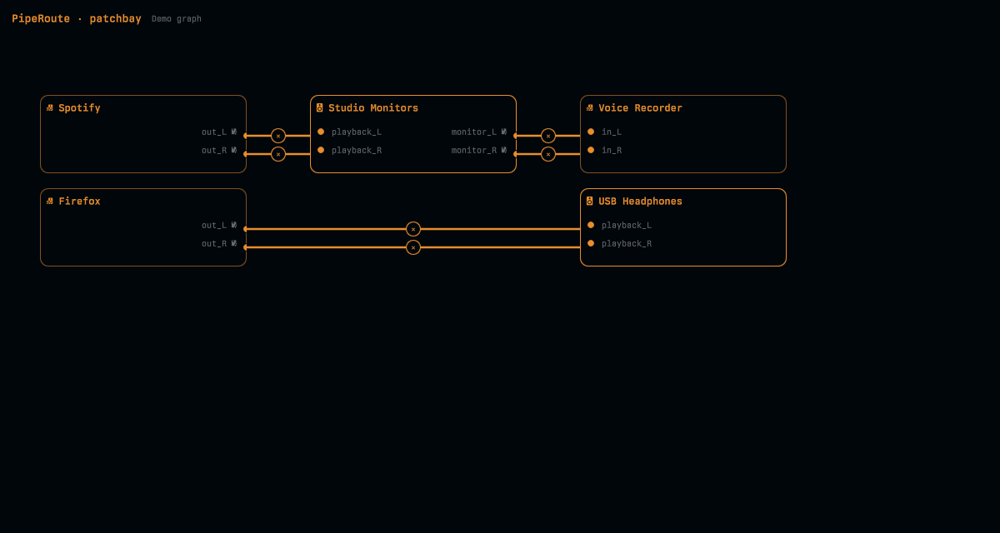
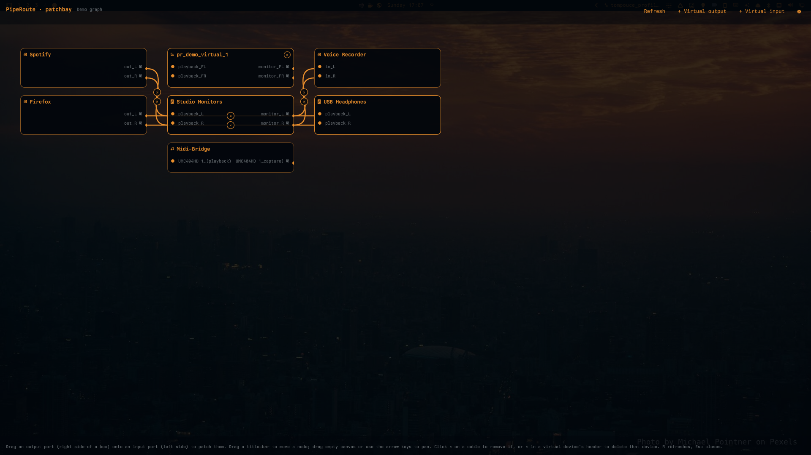

# PipeRoute

[](https://github.com/tcballard/omarchy-badges)

A **graphical PipeWire patchbay** bar widget, in the spirit of qpwgraph and
Carla. It shows the live PipeWire graph as boxes and cables on a full-screen
canvas and lets you edit it by dragging. No daemon, config file or manual setup
of its own.



Kinds: `bar-widget`

## What it does

The bar button shows the routing glyph `󰌘` and the current default output.
Its tooltip summarises default output, default input and stream count.
**Left click opens the graphical patchbay; right click opens a compact menu**
for defaults, stream routing and virtual devices.

### Graphical patchbay (left click)




A full-screen canvas on the monitor you clicked, with:

- **Nodes** — one box per audio node, laid out left-to-right by signal flow:
  outputs-only nodes (playback streams, source devices) on the left, nodes with
  both inputs and outputs (sinks with monitors, virtual devices) in the middle,
  and inputs-only nodes (capture streams) on the right. Each box lists its input
  ports on the left edge and output ports on the right edge. You can drag any
  node elsewhere; its position is kept across refreshes.
- **Cables** — bezier curves drawn between the ports that are actually linked
  in PipeWire. They follow the nodes when you move them.
- **Drag an output port onto an input port** to create a link. A dashed cable
  follows the cursor while you drag, and the bottom edge names the port under
  the cursor.
- **Drag a node by its title bar** to rearrange the canvas.
- **Pan** by dragging empty canvas, by scrolling (Shift for horizontal), or
  with the arrow keys.
- **Click the × at a cable's midpoint** to remove that link.
- **Toolbar** — Refresh, `+ Virtual output`, `+ Virtual input`, Close. `R`
  refreshes, `Esc` closes.
- **Updates** — the canvas re-reads the graph immediately when Quickshell's
  native PipeWire model reports a node or link change (debounced so a burst is
  one read), plus a 5-second safety poll for changes that model doesn't signal
  (such as a null sink created by another client).

Only audio nodes are shown; MIDI bridges and webcam video nodes stay out of
the way.

### Compact menu (right click)

- Create/remove virtual outputs and inputs.
- Set the default output and input.
- Route individual playback/capture streams to a chosen device.
- A shortcut button to open the graphical patchbay.

## How it interfaces with PipeWire

- Bar status and the compact menu use Quickshell's native
  `Quickshell.Services.Pipewire` module: `Pipewire.nodes`, `linkGroups`,
  `defaultAudioSink`/`defaultAudioSource`. Event-driven; no polling while
  closed.
- The canvas reads `pw-dump` for structured nodes, ports and links (including
  the exact port names and link ids), and writes with the installed PipeWire
  tools: `pw-link` to connect/disconnect ports, `pw-cli` to create/destroy
  virtual nodes, `wpctl` for defaults and `pactl` for moving streams.
- Every external value is validated, commands are spawned from argv (never a
  shell), and output is bounded. Node-derived text is sanitised before display
  (`Text.PlainText` everywhere). Live `PwNode` objects are never held by a
  visual delegate — only primitive snapshots — so graph teardowns cannot crash
  the shell.
- The graph read is capped (48 nodes, 20 ports per side, 128 links, a 900 kB
  JSON document) so a pathological session cannot lock or truncate the shell.
  Automatic refreshes are debounced and rate-limited to at most one per second.

All of these tools ship with a normal PipeWire/WirePlumber install.

## Requirements

- Omarchy 4 with the Quattro shell and plugin support.
- A running PipeWire session with WirePlumber, `pw-dump`, `pw-link`, `pw-cli`,
  `wpctl` and `pactl` on `PATH` (the standard Omarchy setup).
- `/usr/bin/python3` for the small control helper. Omarchy ships Python; the
  plugin installs nothing.

No configuration, credentials, service, package or privileged setup is needed.
The plugin talks to the PipeWire session that is already running.

## Installation

```bash
omarchy plugin add https://github.com/ekollof/piperoute.git --enable
```

`omarchy plugin install` is an alias for the same command. The plugin is
self-contained: the manifest, QML, helper and translations are all in the
repository, and enabling it places the bar widget automatically.

From an existing checkout:

```bash
omarchy plugin add "$(pwd)" --enable
```

If the widget is not on the bar, place it with:

```bash
omarchy bar put io.github.ekollof.piperoute --section right
```

The `preview.png` in this repository uses fictional devices and streams; it is
not a capture of a real session.

## Validation and tests

```bash
./tests/run
omarchy plugin validate .
omarchy agent look plugin .
```

`tests/test_model.js` covers markup-shaped node names, node classification and
routing direction; `tests/test_ctl.py` covers input validation and the
structured graph builder that feeds the canvas.

## Update

```bash
omarchy plugin update io.github.ekollof.piperoute
```

## Support

Bugs and feature requests go to the repository's issue tracker. Security
reports go through a private security advisory, not a public issue.

## Tested on

Omarchy source `eb97d5307dd20d6cdf1f78eab31d0b260f50db0d` with Quickshell
0.3.2 (`2b4501a`), PipeWire 1.6.11 and WirePlumber 0.5.19. Other Quattro
versions may differ; the plugin uses only documented hosted QML components and
the installed PipeWire CLI tools.

## Removal

```bash
omarchy plugin remove io.github.ekollof.piperoute
```

The plugin keeps no state of its own. Virtual devices it created remain in the
PipeWire graph until removed (with the canvas toolbar, the compact menu, or
`pw-cli destroy`).

## Access and security model

Omarchy plugins run as unsandboxed code inside `omarchy-shell`, so the
boundary matters:

- **Who can reach the controls.** Only the person at the session. The plugin
  registers no IPC target, no D-Bus service, no socket, no global shortcut and
  no network listener. The overlay opens only from its own bar button and takes
  exclusive keyboard focus only while it is visible.
- **What is executed.** One helper, `bin/piperoute-ctl`, started through the
  omakit `Run` block: absolute executable, argv only, a closed environment, a
  hard deadline and byte/line caps. The helper invokes only the installed
  PipeWire tools (`pw-dump`, `pw-link`, `pw-cli`, `wpctl`, `pactl`), also with
  argv arrays. It never uses a shell or any privilege-escalation tool, and adds
  no privilege: everything it does is what the user can already do with those
  tools.
- **What is written.** Nothing. The plugin has no settings, state or cache
  files. It changes only the live PipeWire graph. Virtual devices it creates
  are ordinary PipeWire nodes and can be removed from the canvas; once the
  plugin is removed, destroy any that remain with `pw-cli destroy`.
- **What is trusted.** Node, port and error text from PipeWire is treated as
  untrusted: sanitised, bounded, and rendered with `Text.PlainText` in every
  sink. There are no credentials, tokens, telemetry or network requests, and
  nothing secret is put in argv or logs.
- **Removal.** `omarchy plugin remove io.github.ekollof.piperoute` deletes the
  plugin directory; no other files or services are touched.

See [SECURITY.md](SECURITY.md) for the security policy, supported versions and
the private reporting link. Report vulnerabilities through GitHub's private
advisory form, not a public issue. The marketplace security baseline and this
README are limited evidence for one commit, not a security audit.

## License

MIT © 2026 Emiel Kollof
